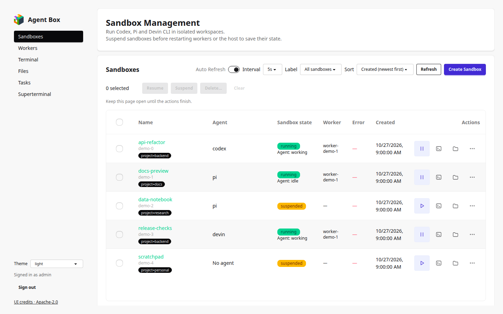
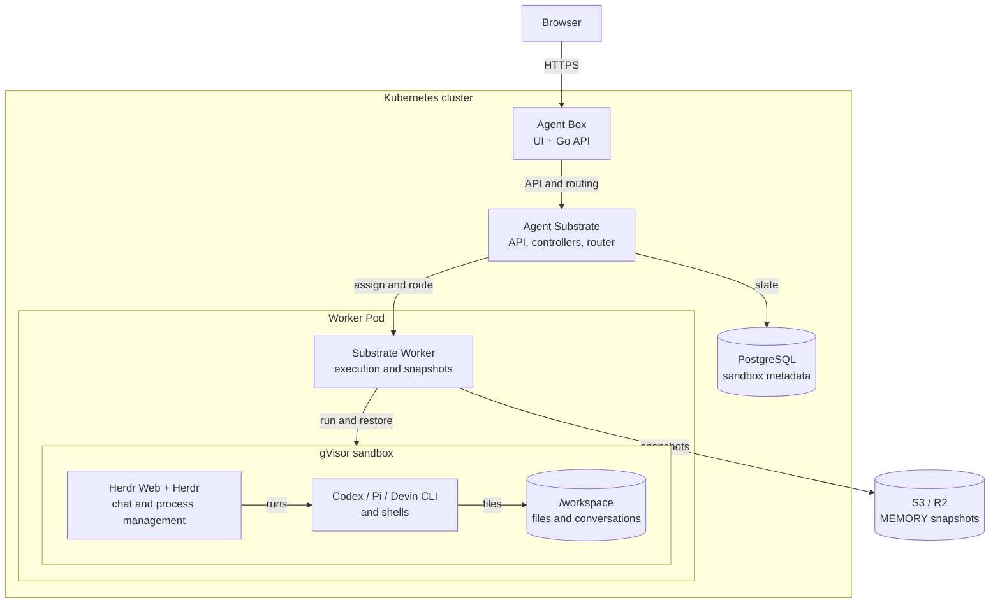

# Agent Box

Self-hosted sandboxes for agents with browser chat, terminals, file management,
and suspend/resume that preserves running processes. Built on Agent Substrate,
gVisor and Herdr.

Agents and shells run as native processes inside gVisor sandboxes. Herdr manages
those processes, and Superterminal embeds Herdr Web for chat and terminal access.
Current agent integrations are Codex, Pi and Devin CLI.

For everyday use, start with the [user guide](docs/README.md).
For installation, see [deployment](docs/DEPLOYMENT.md).



## How it works



Kubernetes runs the panel, Substrate services and Worker Pods. It schedules Pods
on cluster nodes and provides their networking and volumes. Substrate assigns
sandboxes to Workers and manages their lifecycle and snapshots.

Each Worker runs gVisor sandboxes. A sandbox contains its runtime API, Herdr Web,
Herdr, agents and shells. Agents in the same sandbox share its files, CPU and
memory. Herdr manages the native processes and conversation access.

Suspend saves process memory and workspace files to S3/R2. Resume restores them.
Closing the browser leaves the sandbox running. See
[storage configuration](docs/DEPLOYMENT.md#snapshot-storage).

## Features

- Create a sandbox with Codex, Pi or Devin CLI, or start with an empty workspace.
- Run several agents and persistent shells in one sandbox.
- Chat in the browser, upload and download files, and manage directories.
- Suspend and resume sandboxes individually or in groups.
- Restore a crashed sandbox from its last completed snapshot.
- Configure Worker CPU, memory, capacity and scaling through
  [Worker profiles](docs/worker-profiles.md).
- Suspend idle sandboxes after 15 minutes by default. Active agents, background
  work and open shells can keep a sandbox running.

Agent models and authentication depend on the provider account. Codex and Pi
support model presets and custom IDs. Devin CLI uses its own account and model
settings. See [Devin CLI](docs/DEVIN_CLI.md).

## Source and dependencies

| Path | Contents |
| --- | --- |
| `runtime/` | Python helper, agent startup and runtime image |
| `panel/` | Go API, proxy and sandbox lifecycle management |
| `panel/web/` | React interface based on Agent-Sandbox UI |
| `panel/console/` | Herdr Web integration and tests |
| `storage/` | Snapshot archive implementation and Substrate build patch |
| `vendor/substrate/` | Substrate source and Go dependencies |
| `vendor/herdr-web-ui/` | Herdr Web source and dependency notices |
| `deploy/`, `ci/` | Deployment scripts, manifests and build checks |
| `tests/` | Unit and browser integration tests |

Pinned versions include Substrate v0.5.0, Herdr 0.9.5, Herdr Web 0.4.8,
Codex 0.162.1, Pi 1.3.0, Devin CLI 3000.11.205 and ttyd 1.7.7.
Dockerfiles and dependency lockfiles contain the build versions and checksums.
[Third-party notices](THIRD_PARTY_NOTICES.md) list sources and licenses.

Console builds fetch the pinned Herdr Web commit and apply the overlay in
`panel/console/`. Storage builds apply `storage/substrate.patch` and the Go files
in `storage/` to the included Substrate source.

## Build and test

Clone the repository:

```sh
git clone https://github.com/truebest/agent-box.git
cd agent-box
```

Run the image builds and checks from a clean checkout on a Linux x86-64 host
with Docker:

```sh
sh ci/check.sh
```

The script uses the current Git commit to tag the images. It builds the runtime,
panel, Worker and controller, runs their checks, and writes image archives and
checksums to `artifacts/`. Builds download the pinned dependencies and require
internet access.

To run the Python and frontend checks directly:

```sh
python3 -m unittest discover -s tests -v
cd panel/web
npm ci
npm test
npm run lint
npm run build
```

GitHub Actions runs secret scanning, Python tests, frontend tests, lint and the
frontend build. To regenerate the README screenshot after building the frontend,
run `node tests/readme-screenshot.cjs` with Playwright and Chromium installed.
It uses demonstration data. Run browser and integration tests against disposable sandboxes.

## Connect to an installation

Open the installation's HTTPS URL and sign in. Cloudflare Access can add an
organization login before the Agent Box sign-in form.

The Python CLI uses HTTPS Basic authentication. Set its URL and credential paths:

```sh
export AGENT_URL=https://panel.example.com:8443
export AGENT_CA=/secure/path/ca.crt
export AGENT_PASSWORD_FILE=/secure/path/panel-password
python3 agent.py codex-dev --prompt 'Calculate 2+2 using a tool'
python3 agent.py pi-dev --kind pi --model gpt-6.1-sol --cwd /workspace
python3 agent.py devin-dev --kind devin
python3 agent.py codex-dev --suspend
python3 agent.py codex-dev --resume
```

The positional argument is the sandbox name. Keep the CA and password in
protected local files. The CLI endpoint must allow its authentication method.

## Contributing

See [CONTRIBUTING.md](CONTRIBUTING.md) for checks and GitHub pull requests,
and [SECURITY.md](SECURITY.md) for security reports and credential handling.

Agent Box code is licensed under [Apache-2.0](LICENSE). Dependencies keep their
own licenses and copyright notices, listed in
[THIRD_PARTY_NOTICES.md](THIRD_PARTY_NOTICES.md).
